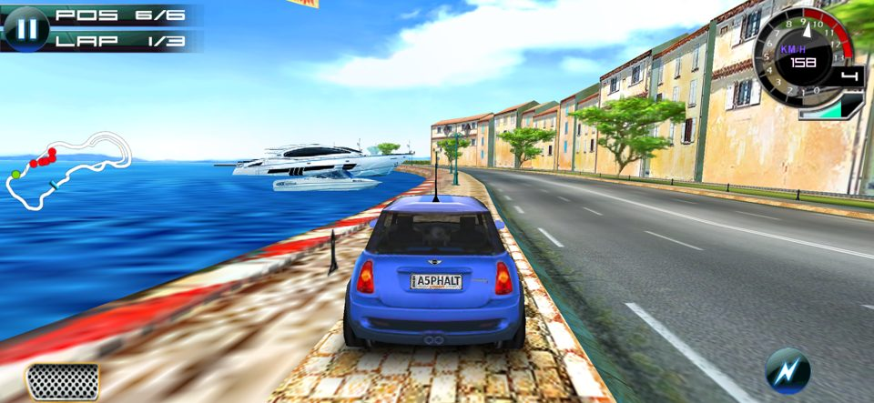
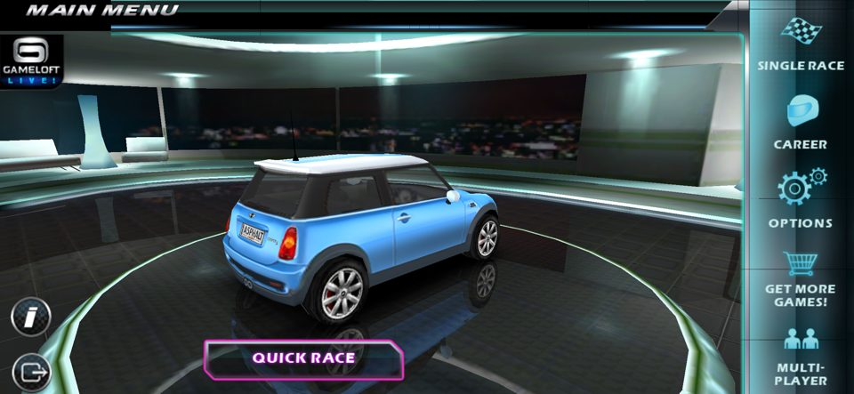
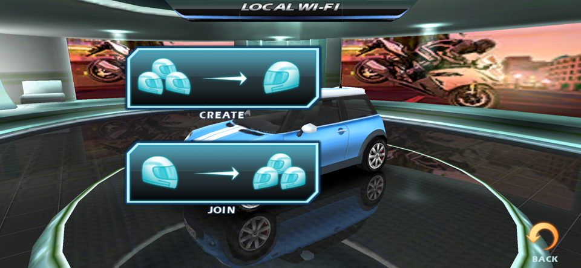
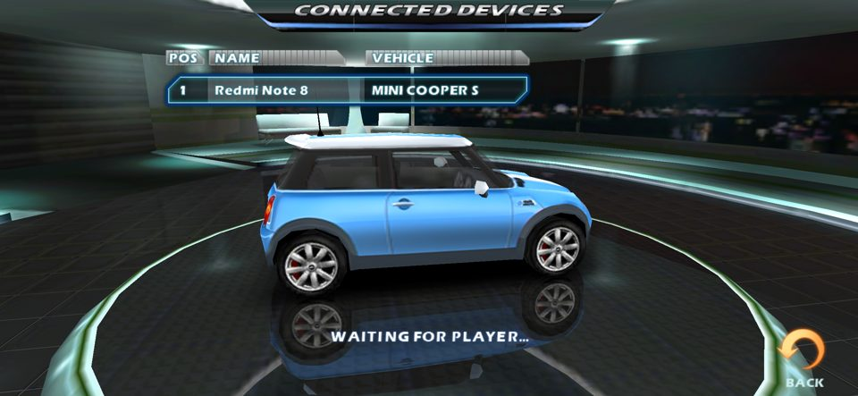

<p align="center">
  
</p>

<h1 align="center">Asphalt 5 Revived</h1>

<p align="center">
  <b>Asphalt 5 HD (2010) corriendo de forma nativa en Android moderno de 64 bits.</b><br>
  Sin emulador, sin JIT, sin librerías de 32 bits: el motor original se traduce a C y se compila para ARM64.
</p>

<p align="center">
  
  
  
</p>

<p align="center">
  
  
</p>

---

## ¿De qué trata?

Asphalt 5 HD salió para Android en 2010 como una biblioteca nativa **ARMv7 de 32 bits** (`libasphalt5.so`). Los teléfonos actuales ya no pueden ejecutarla: los Snapdragon y Exynos recientes no tienen modo de 32 bits, y Google Play exige 64 bits desde 2019. El juego quedó atrapado en hardware antiguo.

**Revived** lo devuelve a la vida sin emular nada en tiempo de ejecución:

1. **Recompilación estática.** Las 5.434 funciones del motor (782.568 instrucciones ARM) se traducen a C con el traductor de [Asphalt5-Native](https://github.com/mrbaazzman/Asphalt5-Native). El NDK compila ese C para **AArch64** y el resultado es una `libasphalt5.so` de 64 bits normal.
2. **Un Android falso para el motor.** El motor sigue creyendo que vive en un teléfono de 2010. Este proyecto le da todo lo que espera: libc de bionic antiguo, OpenGL ES 1.1, un JNIEnv, la JVM y las clases Java originales de Gameloft. Todo traducido a sus equivalentes actuales.
3. **Una app Android nueva.** `GLSurfaceView`, multitáctil, acelerómetro, audio, pausa y almacenamiento, sustituyendo al Java original.

El nombre viene de **Asphalt 5 · Android · revive + evolved**: el mismo juego, en un Android que evolucionó.

## Qué funciona

| | |
|---|---|
| ✅ Portada, menús 3D, carga y carreras | Verificado en Redmi Note 8 y Samsung Galaxy S25 Ultra (Android 17) |
| ✅ Pantalla completa en cualquier proporción | El lienzo se ensancha a la pantalla (p. ej. 1040×480 en 19,5:9); el 3D se dibuja a la resolución nativa |
| ✅ Texturas PVRTC | Se descomprimen por software si la GPU no las soporta |
| ✅ Táctil, teclas y acelerómetro | Con el mismo contrato que el Java original |
| ✅ Audio | Efectos con `SoundPool` y música con `MediaPlayer` |
| ✅ **Multijugador WiFi local** | Reactivado: esta versión lo ocultaba tras un botón ONLINE que ya no funciona. Sala y sockets verificados; falta probar una carrera entre dos teléfonos |
| ❌ Multijugador online | Dependía de servidores de Gameloft cerrados hace años |
| ⏳ Vídeos de introducción | Se omiten de momento |

<p align="center">
  
  
</p>

## Cómo funciona por dentro

```
 libasphalt5.so (ARMv7, 2010)
        │  armrecomp.py (Asphalt5-Native)
        ▼
 ~80 archivos C  ──► NDK clang (aarch64, -O1 -fwrapv) ──► libasphalt5.so (ARM64)
                                                               │
             ┌──────────────────────── runtime nativo ─────────┤
             │  imports_android.c  libc/stdio/libm de bionic    │
             │  net_android.c      sockets e hilos reales       │
             │  gles_bridge.c      GLES 1.1 → driver Android     │
             │  guest_jni.c        JNIEnv/JavaVM para el motor   │
             │  game_host.c        ciclo de vida del juego       │
             └──────────────────────────────────────────────────┘
                                                               │
                                   GameActivity (Java) ◄───────┘
```

Las direcciones del motor siguen siendo de 32 bits: el runtime reserva 4 GiB y cada puntero del juego es un desplazamiento dentro de esa reserva. Los detalles de ABI que había que acertar están en [docs/NATIVE_PORT.md](docs/NATIVE_PORT.md): `_ctype_` como puntero, argumentos variables softfp, estructuras de red de 32 bits, el contrato de audio del Java original, etc.

## Compilar

> **Necesitas tu propia copia legal de Asphalt 5 HD 3.4.1** (APK y carpeta de datos). Este repositorio no contiene ni distribuye archivos del juego.

Requisitos: Python 3 con `capstone==5.0.9` y `pyelftools==0.32`, Android NDK r28, SDK de plataforma 36 con Build Tools 36.0.0 y un JDK.

```powershell
git clone https://github.com/codepdbh/asphalt5-revived
cd asphalt5-revived
git clone https://github.com/mrbaazzman/Asphalt5-Native references/Asphalt5-Native
git -C references/Asphalt5-Native checkout f977989fa74faeb2442831f1241b4943d5459322
python -m pip install capstone==5.0.9 pyelftools==0.32

# Copia tu APK a a5/ y la carpeta de datos a a5/datos/asphalt5/, luego:
python scripts/build_port.py a5/<tu-asphalt5-3.4.1>.apk --install --push-data --launch
```

El script comprueba el SHA-256 de la biblioteca original, traduce el motor una sola vez (queda en caché), compila de forma incremental, empaqueta, firma e instala. Con `--boot-probe` ejecuta una prueba rápida del motor por ADB.

## Jugar

- Los datos del juego van en la memoria interna, en **`/sdcard/gameloft/games/asphalt5/`**, la misma ruta que el original. La app pide el permiso *Acceso a todos los archivos* la primera vez.
- **Multijugador local:** los dos teléfonos en la misma WiFi (o uno compartiendo red al otro) → *MULTIPLAYER → LOCAL* → uno *CREATE* y el otro *JOIN*.

## Créditos

- **[Asphalt5-Native](https://github.com/mrbaazzman/Asphalt5-Native)** de mrbaazzman: traductor ARM→C, núcleo del invitado y la corrección de `CMatrix`. Licencia MIT.
- **PowerVR Native SDK** (Imagination Technologies): descompresor PVRTC. Licencia MIT, en [`third_party/powervr`](third_party/powervr).
- Asphalt 5 es una marca de **Gameloft**. Este es un proyecto de preservación sin relación con Gameloft ni respaldo suyo. No incluye código, recursos ni datos del juego.

## Licencia

El código de este repositorio se publica bajo la [licencia MIT](LICENSE). El juego original y sus datos siguen perteneciendo a sus titulares.
